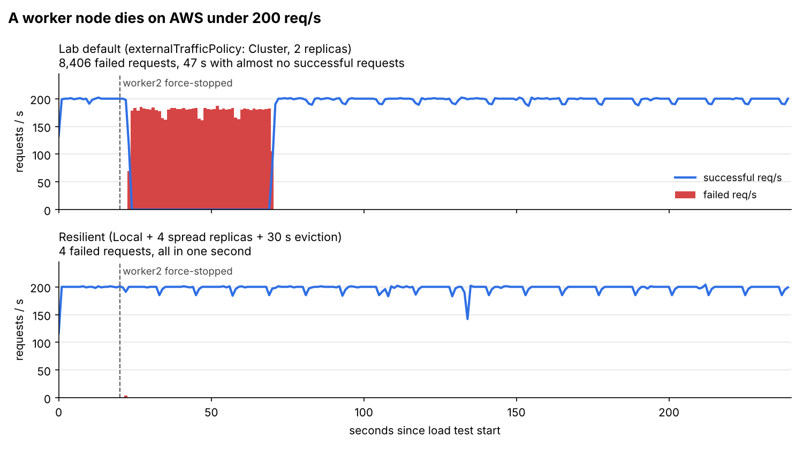

# What happens when a Kubernetes node dies on AWS, measured

**In plain words:** my service runs on two servers behind a load balancer. I switched one server off in the middle of heavy traffic and counted how many users got an error, for how long, and why. Then I changed the setup until switching a server off cost almost nothing.

| Setup | Failed requests when a worker node died | Seconds with errors |
|---|---|---|
| Lab default (`externalTrafficPolicy: Cluster`, 2 replicas) | **8,406** of 46,647 (18%) | **47 s**, with almost no successful request in that time |
| Resilient (`Local` + 4 spread replicas + 30 s eviction) | **4** of 47,477 | **under 1 s** |

The surprise: in the default setup one dead server took down **the whole service**, not half of it. The healthy worker kept forwarding part of its traffic to the dead one, so Nginx concluded that both workers were dead (details in E3).



**Stack:** AWS EC2 · Pulumi · K3s (1 master, 2 workers) · Nginx Layer 4 load balancer · Java 21 / Spring Boot 3 · Python load tester

Follows [zero-downtime-k8s](https://github.com/Rayhanshuvo/zero-downtime-k8s), which measured planned changes (rollouts, rollbacks, a deleted pod) on a single node. This project measures the unplanned one: a whole server disappearing.

---

## Architecture

```
                 you / load tester
                        |
                        v  :80
            +-----------------------+
            |  nginx  (EC2 t2.micro)|   Layer 4: forwards TCP, does not read HTTP
            +-----------------------+
               |                 |      private IPs, :30001 (NodePort)
               v                 v
     +----------------+   +----------------+        +----------------+
     | worker1 (t3.s) |   | worker2 (t3.s) |        | master (t3.s)  |
     | kube-proxy     |<->| kube-proxy     |        | K3s server     |
     | whoami pods    |   | whoami pods    |        | (control plane)|
     +----------------+   +----------------+        +----------------+
            all in one VPC (10.0.0.0/16), public subnet, ap-southeast-1
```

Every response from the Spring Boot app says **which pod and which node** answered (`/api/whoami`), so the load tester can show, second by second, where traffic goes and what happens when one node is gone.

## The question

When a worker node dies without warning, two separate systems have to notice:

1. **Nginx** must stop sending connections to the dead server. It finds out when a connect attempt times out (`proxy_connect_timeout 1s`, then it retries the other worker).
2. **Kubernetes** must stop routing to pods on the dead server. It finds out only when the node stops reporting and is marked `NotReady` (typically 40 to 50 seconds), and it replaces those pods only after a toleration expires (300 seconds by default).

With the default `externalTrafficPolicy: Cluster`, kube-proxy on the **surviving** node forwards part of its traffic to pods on the **dead** node until step 2 happens. So the expected weak spot is not Nginx, it is the gap before Kubernetes reacts. The experiments measure that gap and close it.

## Experiments

Same procedure for each: load through Nginx (10 parallel clients, max 200 requests/second), and for failure runs, worker2 is force-stopped (`aws ec2 stop-instances --force`) at second 20. A watcher on the master logs, once per second, node status and which pod IPs are behind the Service, so the user-side errors can be lined up with what the cluster did (`scripts/timeline.py`).

### E1: How Nginx and kube-proxy share traffic

```bash
make deploy STEP=1-baseline DOCKERHUB_USER=<you>
make experiment NAME=e1-baseline DURATION=60
```

**Hypothesis:** about 50/50 between worker1 and worker2. But not only because of Nginx: with `Cluster`, a connection that reaches worker1 can be served by the pod on worker2 (a second hop, and the app sees a node IP instead of the real client IP).

**Result** ([raw output](results/e1-baseline.txt)):

| Requests | Failed | worker1 / worker2 | Latency p50 / p99 |
|---|---|---|---|
| 11,930 | **0** | 50.4% / 49.6% | 27 ms / 35 ms |

The second hop is visible in the responses: the app saw `seenClientIp` values of `10.42.1.0` and `10.42.2.1`, which are node addresses inside the cluster, never the Nginx IP. A request that entered through worker1 and was answered by the pod on worker2 arrives with worker1's address.

### E2: `externalTrafficPolicy: Local` with a node that has no pod

```bash
make deploy STEP=2-local DOCKERHUB_USER=<you>
make scale REPLICAS=1
make experiment NAME=e2-local-one-pod DURATION=60
```

**Hypothesis:** no second hop, and the app sees the Nginx IP as client. But the worker without a pod does not answer on 30001 at all, so every connection Nginx sends there waits for the 1 s connect timeout before being retried: no errors, but slow requests.

**Result** ([raw output](results/e2-local-one-pod.txt)):

| Requests | Failed | Answered by | Slow (> 900 ms) | Latency max |
|---|---|---|---|---|
| 11,652 | **0** | worker1 100% | 15 | 1,386 ms |

As expected, no errors and no second hop. The cost showed up as a regular dip about every 12 seconds (seconds 12, 24, 36, 48): Nginx tried worker2, waited for the 1 s connect timeout, retried on worker1, then skipped worker2 for 10 s (`fail_timeout`) before trying again. `Local` is only safe when every node that receives traffic has a local pod.

### E3: A worker dies, lab default setup

```bash
make deploy STEP=1-baseline DOCKERHUB_USER=<you>     # check: one pod on each worker
make experiment NAME=e3-node-down EVENT=stop-worker2 DURATION=240
make start-worker2 && make rebalance
```

**Hypothesis:** Nginx reacts within about a second, but worker1's kube-proxy keeps sending part of the traffic to the dead pod until the node is marked `NotReady`. Expect failures (timeouts) for 40 to 50 seconds, and the dead pod is not replaced during the whole run (300 s default).

**Result** ([raw output](results/e3-node-down.txt), [timeline](results/e3-node-down-timeline.txt)):

| Requests | Failed | Error types | Error window | worker2 marked `NotReady` |
|---|---|---|---|---|
| 46,647 | **8,406 (18%)** | 6,335 connection closed, 2,071 connection reset | 23.6 s to 70.6 s (**47 s**) | 45 s after it was stopped |

Timeline:

| Time | What happened |
|---|---|
| 20.0 s | worker2 force-stopped |
| 23.6 s | first failed request |
| 24 s to 69 s | **zero successful requests per second**, although worker1 and its pod were healthy |
| 65.1 s | Kubernetes marks worker2 `NotReady` and removes its pod from the Service |
| 70.6 s | last failed request; worker1 serves everything from here on |
| 240 s | the dead pod was still not replaced (default eviction waits 300 s) |

**Why the healthy worker failed too:** the hypothesis was that about half the requests would fail. All of them did. With `Cluster`, worker1's kube-proxy kept sending about half of its connections to the pod on the dead node, and those connects timed out. Nginx counted those timeouts against **worker1**, and with `max_fails=1` it took worker1 out of rotation too. With both upstreams marked down, Nginx most likely had no server left and closed client connections immediately, which matches the instant `connection closed` / `connection reset` errors (Nginx's error log would show `no live upstreams`; not captured in this run). The cycle repeated every `fail_timeout` until Kubernetes removed the dead endpoint at 65 s.

So the outage was not set by Nginx (it noticed in about a second) but by Kubernetes' node failure detection, about 45 seconds.

### E4: A worker dies, resilient setup

```bash
make deploy STEP=3-resilient DOCKERHUB_USER=<you>   # check: two pods on each worker
make experiment NAME=e4-resilient-node-down EVENT=stop-worker2 DURATION=240
make start-worker2 && make rebalance
```

What changes:

| Setting | Why |
|---|---|
| `externalTrafficPolicy: Local` | worker1 only ever sends to its own pods, so the dead node's pods are never in its path |
| 4 replicas, `topologySpreadConstraints` | each worker always has local pods, which avoids E2's problem |
| `tolerationSeconds: 30` for `unreachable` / `not-ready` | pods on a dead node are replaced after 30 s, not 300 s |
| Nginx: `max_fails=1 fail_timeout=10s`, `proxy_next_upstream` | after one failed connect, Nginx skips the dead worker for 10 s and retries the other one |

**Hypothesis:** close to zero failed requests. The cost shows up as a few slow requests (about 1 s) while Nginx discovers the dead worker.

**Result** ([raw output](results/e4-resilient-node-down.txt), [timeline](results/e4-resilient-node-down-timeline.txt)):

| Requests | Failed | Error window | Slow (> 900 ms) | worker2 `NotReady` | Replacement pods ready |
|---|---|---|---|---|---|
| 47,477 | **4** | one second (22.4 s) | 19 | 36 s after the stop | 86 s after the stop |

The 4 failures were connections already in flight to worker2 at the moment it died. From then on worker1 answered every request (200 per second, with no gap), because it only forwards to its own two pods and Nginx only ever saw worker2 fail. The replacement pods came up on worker1 50 s after the node was marked `NotReady` (30 s toleration plus start-up), compared with never in E3.

The remaining cost is the same as in E2: 19 requests took about 1 s, once every ~12 s, when Nginx re-tested the dead worker.

## Key learnings

1. **A load balancer's health check can only be as good as the path behind it.** With `externalTrafficPolicy: Cluster`, a healthy node's NodePort can still lead to a dead pod, so a passive health check blames the healthy node. One dead server became a full outage.
2. **Kubernetes needs about 40 seconds to notice a dead node.** Anything that relies on Kubernetes to stop routing (Service endpoints, kube-proxy) inherits that gap. In this setup only `Local` routing kept traffic away from the dead node without waiting for Kubernetes.
3. **`Local` needs a pod on every node that gets traffic.** On its own it trades errors for slow requests (E2). Together with spread replicas it is the fix (E4).
4. **Default eviction is slow.** Pods on an unreachable node are replaced after 300 s by default; `tolerationSeconds: 30` brought that down to well under two minutes.

## Planned next

- **E5, tune Nginx:** a higher `max_fails` / shorter `fail_timeout` in the default setup, to measure how much of E3 a load balancer setting alone can fix.
- **E6, planned maintenance:** `kubectl drain` a worker with a `PodDisruptionBudget`, which should be completely invisible to users thanks to `preStop` and graceful shutdown.
- **E7, Layer 7:** the same failure behind an HTTP (L7) load balancer that retries failed requests, compared with this L4 setup.

## Run it yourself

Requirements on your machine: AWS CLI (configured), Pulumi (`pulumi login --local` works), Node.js, Docker, Python 3, a Docker Hub account.

```bash
make keys                       # EC2 key pairs -> infra/*.pem (git-ignored)
make infra                      # VPC + nginx + master + 2 workers (Pulumi)
make env                        # Pulumi outputs -> .env.mk and ssh/config
make image DOCKERHUB_USER=<you> # Spring Boot image, built for linux/amd64, pushed
make k3s                        # K3s on master, workers joined and labelled role=worker-node
make nginx                      # Layer 4 load balancer with the workers' private IPs
make deploy STEP=1-baseline DOCKERHUB_USER=<you>
make check                      # 6 requests: which node answered?
make ports                      # the lab's telnet checks (nc): you -> :80, nginx -> :30001
```

Then the experiments above. When finished: **`make destroy`** (the instances cost money while they run).

`make help` lists every target. Optional: `pulumi config set adminCidr <your-ip>/32` (in `infra/`) before `make infra` to allow SSH and HTTP only from your own IP.

## Repository layout

| Path | What it is |
|---|---|
| `app/` | Spring Boot service: `/api/whoami` returns pod, node, pod IP, and the client IP it sees |
| `infra/` | Pulumi program (VPC, subnet, security group, 4 EC2 instances) |
| `k8s/1-baseline` | the lab's Deployment + NodePort Service, with probes added |
| `k8s/2-local` | same, with `externalTrafficPolicy: Local` |
| `k8s/3-resilient` | 4 spread replicas, short eviction, graceful shutdown, `Local` |
| `nginx/` | Layer 4 (`stream`) config template and Dockerfile |
| `scripts/loadtest.py` | constant-rate load tester, counts answers per node, can trigger an event |
| `scripts/watch-cluster.sh` | runs on the master, logs node status and Service endpoints every second |
| `scripts/timeline.py` | merges load-test and cluster logs into one timeline |
| `scripts/plot.py` | chart of requests per second for several runs |
| `results/` | raw output of every run |

## Changes from the Poridhi lab

- Flask replaced by a Spring Boot service that reports which pod and node answered.
- The lab's Kubernetes manifest has broken indentation; fixed here.
- Workers join the master and Nginx reaches the workers over **private** IPs.
- The security group allows all traffic only inside the VPC; SSH and HTTP from outside can be limited to one IP.
- The whole lab is scripted (`make`), and every step after it is measured.
- The lab network blocked `update.k3s.io`, so the K3s version is pinned (`v1.31.4+k3s1`) and downloaded from GitHub.
